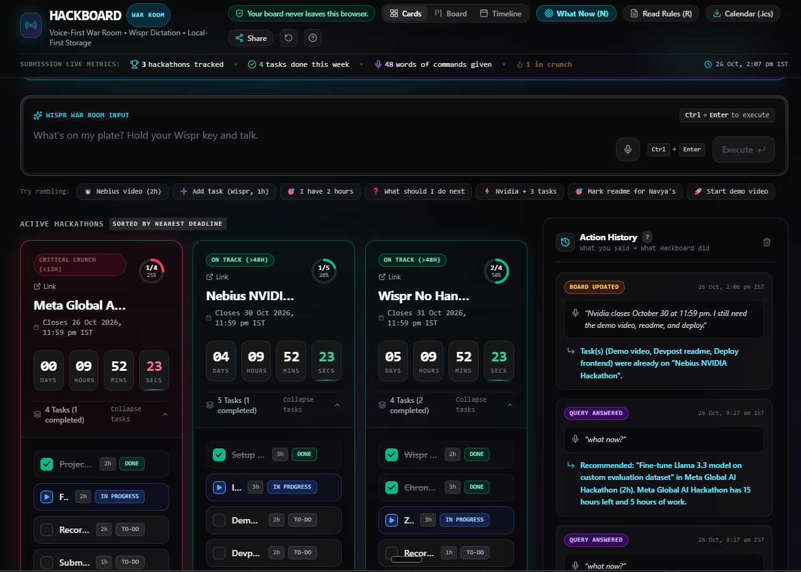

# Hackboard

> A voice-first war room for people juggling several hackathons at once.

**Live App:** [https://hackerboard.vercel.app](https://hackerboard.vercel.app)  
*Opens instantly without signing in, preloaded with three sample hackathons so judges can try it in 60 seconds.*

---

## Screenshot



---

## Try it in 60 seconds

1. Open [https://hackerboard.vercel.app](https://hackerboard.vercel.app).
2. Click **Try it in 60 seconds** on the top welcome strip to run the interactive guided tour.
3. Type or dictate `what now` into the command bar and press `Ctrl + Enter`.
4. Switch views using keyboard shortcuts: press `K` for the Kanban Board and `T` for the Timeline.
5. Click **Read rules** and paste raw hackathon guidelines into the Rules Reader.

---

## The problem

I'm a student doing three or four hackathons at the same time. Deadlines, rules and tasks are spread across Devpost, Discord, email and my calendar, and I lose time every day just working out what to do next. This is for students and indie builders running several hackathons in parallel.

---

## How I built it with Wispr Flow

I dictated every Antigravity prompt, the commit messages, this README and the demo narration with Wispr Flow, and talked through each screen out loud instead of typing. I dictated [WORD COUNT] words in total during the build. The app is also designed for dictation: you speak a ramble and it turns it into hackathons, deadlines and tasks.

---

## Real usage

I used it to run my own [NUMBER] live hackathons this week.

---

## Features

- **Voice and text command bar with local parsing:** Speak or type natural rambling commands with fuzzy matching, Indian Standard Time (IST) date extraction, and zero external API dependencies.
- **Countdown cards with urgency colors:** Dynamic live ticking countdowns (green for >48h, amber for &le;48h, red for &le;12h crunch).
- **Kanban board with drag and drop:** Three-column workflow (To Do, Doing, Done) with mouse drag-and-drop and real-time voice status sync.
- **What Now focus suggestions with slack scoring and Pomodoro timer:** Intelligent prioritization picking the single best task based on deadline urgency and remaining work slack, complete with a 25-minute focus sprint timer.
- **Overbooked alerts:** Warning banners warning when remaining task hours exceed time left before deadline.
- **Rules Reader:** Pastes hackathon submission guidelines or terms, automatically extracting deadlines, deliverables, and checklists into actionable tasks.
- **Timeline view:** Pure HTML and Tailwind 24-hour day scale Gantt operations view with real-time countdown bars and a live "Now" indicator.
- **Calendar export:** Generates and downloads an RFC 5545 `.ics` file with all deadlines in IST and 24h/2h reminders.
- **Share links:** Stateless board sharing by compressing the entire state into URL hash fragments via `lz-string` with zero backend servers.
- **Keyboard shortcuts:** Case-insensitive shortcuts (`K` for board, `T` for timeline, `N` for what now, `R` for rules reader, `?` for cheat sheet).

---

## Example commands

| Voice / Dictated Command | What Hackboard Does |
| :--- | :--- |
| `um so Nvidia closes October 30 at 11:59 pm. I still need the demo video, readme, and deploy.` | Detects NVIDIA hackathon deadline, creates it if missing, and splits items after "need" into 3 tasks. |
| `so like mark readme for Navya's` | Resolves speech error "Navya's" to NVIDIA and toggles the README task status. |
| `what now?` | Scores all incomplete tasks across all hackathons by least slack and presents the top focus task. |
| `hey I have 2 hours what should I do` | Filters tasks to find the highest-impact deliverable that fits within a 2-hour work window. |
| `demo video for Nebius takes 2 hours` | Locates the demo video task under Nebius and updates its estimate to 2 hours. |
| `show timeline` | Seamlessly switches the war room interface to the Operations Timeline view. |

---

## Privacy

No backend, no API keys, no accounts. Everything stays in your browser's local storage. Your board never leaves this browser.

---

## Tech stack and running locally

- **Framework:** Next.js (Static HTML Export `output: 'export'`)
- **Language:** TypeScript
- **Styling:** Tailwind CSS
- **Deployment:** Vercel

### Running Locally

```bash
# 1. Install dependencies
npm install

# 2. Run local development server
npm run dev

# 3. Run parser verification test suite (32 dictation tests + math unit tests)
npm test

# 4. Build static export
npm run build
```

---

## Built for

Built for [No Hands: The Wispr Challenge](https://wemakedevs.org/wispr) by WeMakeDevs and Wispr Flow.
